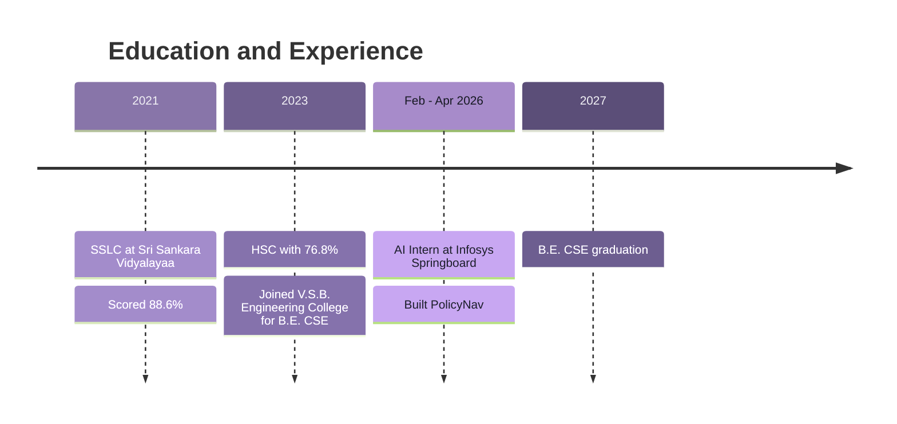

<div align="center">

<p align="center">
  <br/>
  
</p>


<br/><br/>

<a href="https://portfolio-gv18.vercel.app/"></a>
<a href="https://www.linkedin.com/in/poojak-k/"></a>
<a href="mailto:poojakathirvelv@gmail.com"></a>
<a href="https://github.com/PoojaK-K"></a>

<br/><br/>


<br/><br/>

<a href="#about"></a>
<a href="#tech-stack"></a>
<a href="#featured-projects"></a>
<a href="#experience--certifications"></a>
<a href="#github-statistics"></a>
<a href="#lets-connect"></a>

</div>

---

## About

Computer Science student who enjoys building AI-powered, database-driven software, from backend APIs to the interfaces on top of them.

```python
class PoojaKK:
    role       = "AI & Full-Stack Developer"
    education  = "B.E. Computer Science & Engineering, V.S.B. Engineering College (2023 - 2027)"
    experience = "AI Intern, Infosys Springboard (Feb - Apr 2026)"
    location   = "Karur, Tamil Nadu, India"

    strengths  = ["Java", "Python", "SQL", "OOP", "DBMS", "Data Structures & Algorithms"]
    building   = ["AI-powered full-stack apps", "RAG-based document intelligence"]
    exploring  = ["AI Agents", "Cloud Computing", "System Design"]
    open_to    = ["Software Development", "Backend Engineering", "AI Applications"]

    def mindset(self):
        return "Always curious to learn, build, and innovate."
```

<details>
<summary><b>Ask me about</b> &nbsp;<i>(click to expand)</i></summary>
<br/>

- Building a RAG pipeline for document question answering
- Extracting data from scanned documents with OCR
- Turning AI prototypes into full-stack applications
- Why good backend design matters as much as the AI on top of it

</details>

---

## Tech Stack

| Category | Technologies |
|:--|:--|
| **Programming Languages** |      |
| **Frontend Development** |     |
| **Backend Development** |    |
| **Databases** |     |
| **AI & Machine Learning** |        |
| **Developer Tools** |       |

---

## Featured Projects

> Click a project to expand it.

<details open>
<summary><b>MediSense AI</b> &nbsp;·&nbsp; Medical Report Analyzer &amp; Summarizer</summary>
<br/>


An AI-powered system that extracts text from PDF and image-based medical reports, summarizes the findings and detects abnormal values.

- Secure report storage with patient history
- Interactive dashboards
- Healthcare chatbot for follow-up questions

    

<!-- Add links when ready: [View Code](https://github.com/PoojaK-K/REPO-NAME) · [Live Demo](DEMO-URL) -->

</details>

<details>
<summary><b>EduCompass</b> &nbsp;·&nbsp; AI-Powered Student Planning Assistant</summary>
<br/>


A student assistant that provides personalized career plans, study schedules, course recommendations and wellness support.

- User-based recommendations
- Feedback system to improve personalization and engagement

 

<!-- Add links when ready: [View Code](https://github.com/PoojaK-K/REPO-NAME) · [Live Demo](DEMO-URL) -->

</details>

<details>
<summary><b>PolicyNav</b> &nbsp;·&nbsp; AI Public Policy Navigator</summary>
<br/>


Built during my Infosys Springboard internship. Simplifies government policy documents using Retrieval-Augmented Generation (RAG), semantic search and knowledge graphs.

- Document summarization
- AI-based information retrieval

   

<!-- Add links when ready: [View Code](https://github.com/PoojaK-K/REPO-NAME) · [Live Demo](DEMO-URL) -->

</details>

<details>
<summary><b>Automated Translation in Live Sessions</b> &nbsp;·&nbsp; Real-Time Speech Translation</summary>
<br/>


A multilingual speech translation platform combining speech recognition, machine translation, subtitles and speech synthesis.

- Speech recognition
- Machine translation with live subtitles
- Speech synthesis

   

<!-- Add links when ready: [View Code](https://github.com/PoojaK-K/REPO-NAME) · [Live Demo](DEMO-URL) -->

</details>

<details>
<summary><b>LumoCart</b> &nbsp;·&nbsp; AI-Powered E-Commerce Platform</summary>
<br/>


An e-commerce platform with product browsing, user authentication and a smart shopping experience.

- Product browsing
- User authentication

  

<!-- Add links when ready: [View Code](https://github.com/PoojaK-K/REPO-NAME) · [Live Demo](DEMO-URL) -->

</details>

<details>
<summary><b>BloodBridge</b> &nbsp;·&nbsp; Blood Donation Management System</summary>
<br/>


A management system that connects blood donors and recipients through an easy-to-use platform.

- Connects donors and recipients

<!-- Add tech stack badges here once confirmed -->

<!-- Add links when ready: [View Code](https://github.com/PoojaK-K/REPO-NAME) · [Live Demo](DEMO-URL) -->

</details>


<div align="center">
<a href="https://github.com/PoojaK-K?tab=repositories"></a>
</div>

---

## Experience & Certifications



<details open>
<summary><b>AI Intern, Infosys Springboard</b> &nbsp;·&nbsp; Feb 2026 – Apr 2026 &nbsp;·&nbsp; Virtual</summary>
<br/>

- Developed **PolicyNav**, an AI-powered public policy navigation solution for document summarization and information retrieval
- Gained hands-on experience with Generative AI, RAG, document processing and AI-based information retrieval

</details>

<details>
<summary><b>Education</b> &nbsp;·&nbsp; CGPA 7.90 (up to 6th semester)</summary>
<br/>

| Period | Qualification | Institution | Score |
|:--|:--|:--|:--|
| 2023 – 2027 | B.E. Computer Science & Engineering | V.S.B. Engineering College, Karur (Anna University) | CGPA 7.90 |
| 2023 | HSC (CBSE) | Sri Sankara Vidyalayaa, Karur | 76.8% |
| 2021 | SSLC (CBSE) | Sri Sankara Vidyalayaa, Karur | 88.6% |

</details>

<details open>
<summary><b>Certifications</b></summary>
<br/>

| Certification | Issuer | Result |
|:--|:--|:--|
| **Programming in Java** | NPTEL | Elite · 87% |
| **Python Programming** | Livewire India | Completed |
| **Principles of Generative AI** | Infosys Springboard | Completed |

</details>

---

## GitHub Statistics

<div align="center">


<br/><br/>

<a href="https://github.com/PoojaK-K"></a>

</div>

---

## Currently Learning & Goals

<div align="center">

    

</div>

<details>
<summary><b>2026 goals</b> &nbsp;<i>(click to expand)</i></summary>
<br/>

- Build impactful AI-powered applications
- Contribute to open source
- Strengthen system design and backend development
- Learn and implement one new technology every month
- Keep improving problem-solving skills

</details>

---

## Let's Connect

<div align="center">

<a href="mailto:poojakathirvelv@gmail.com"></a>
<a href="https://www.linkedin.com/in/poojak-k/"></a>
<a href="https://portfolio-gv18.vercel.app/"></a>

<br/><br/>

*"Turning ideas into intelligent software through continuous learning and innovation."*

</div>
